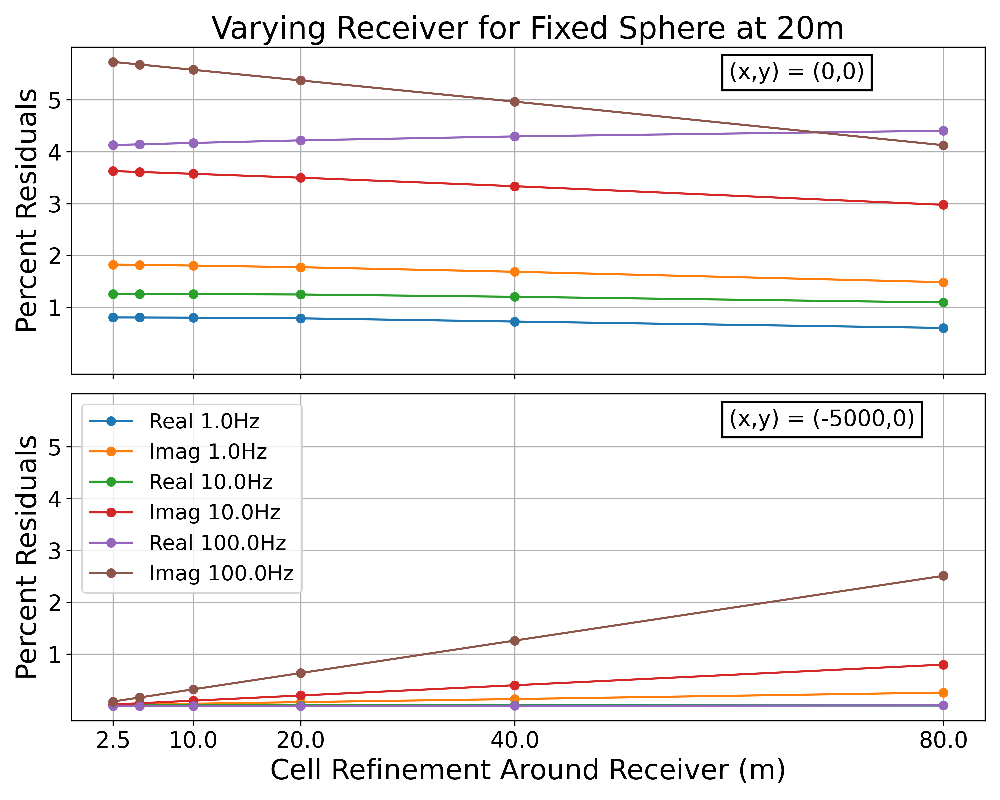
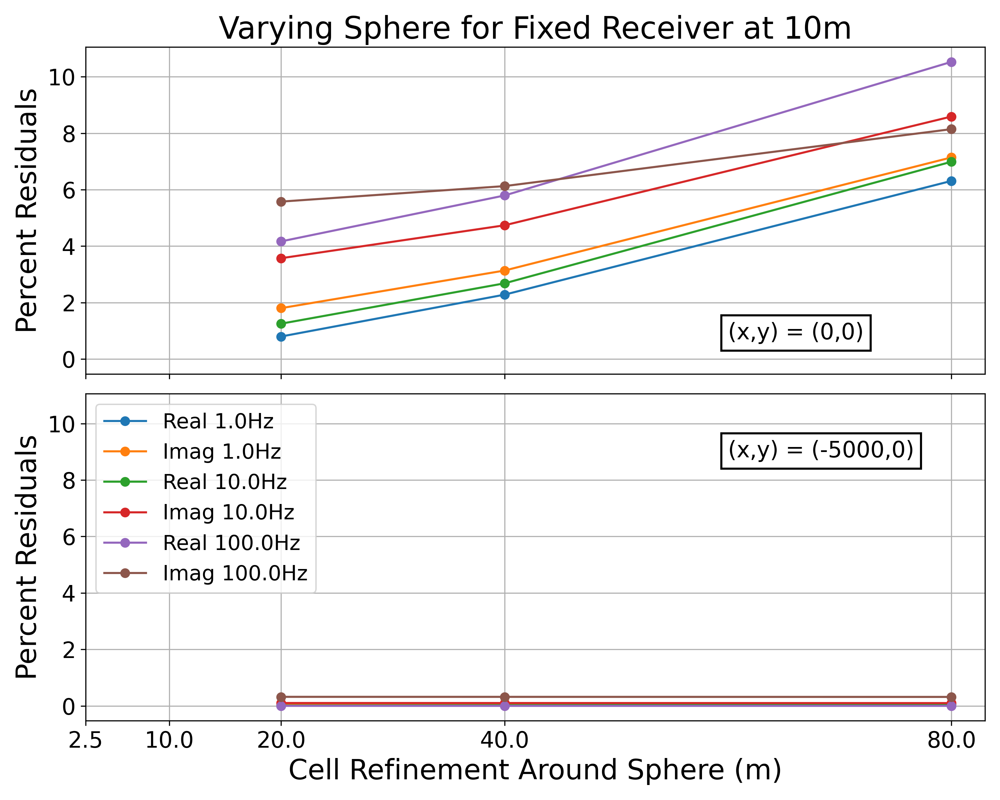

# Techniques for Improving MT Forward Simulations with Octree Meshes

Mesh refinement drives a tradeoff between accuracy and computational costs for Magnetotelluric forward modelling. We conduct simulations in the SimPEG framework to investigate this tradeoff and evaluate various Octree mesh refinement schemes against the analytic solution for a conductive sphere in a resistive halfspace. We also present volume averaging techniques to reduce inaccuracies associated with representing the sphere using discretized cells.

Two refinement scheme parameters are studied: refinement around the sphere and refinement around the receivers. Comparison to the analytic solution and computation time are used as figures of merit as these parameters are independently varied. The percent residuals of the simulated impedances follow a linear relationship as refinement is varied ().

::::{figure}
:label: fig:refinement
:align: center

:::{grid} 2

:::

Impedance residuals for varying refinement schemes. The same mesh is used to simulate all frequencies.
::::

Volume averaging techniques are applied to the model by assigning conductivities based on the fraction of a cell which is enclosed within the sphere. Methods favouring lower conductivities such as harmonic averaging were found to be more effective than methods favouring higher conductivities, such as geometric averaging. Using the method of harmonic averaging, the percent residuals above the sphere can be reduced by more than a factor of two. The submitted results leverage this technique to produce a model with impedance residuals under $1\%$ for low frequencies (up to 1 Hz) and under $5\%$ for the mid to high frequencies (up to 1 kHz), all while using less than half the computation time and memory required for an equivalently performing mesh built from the standard cutoff procedure ().

:::{figure} figures/centerResidualsCells.png
:label: fig:tradeoff
:align: center
:width: 80%

Harmonic averaged mesh improvements for varying cell counts.
:::
